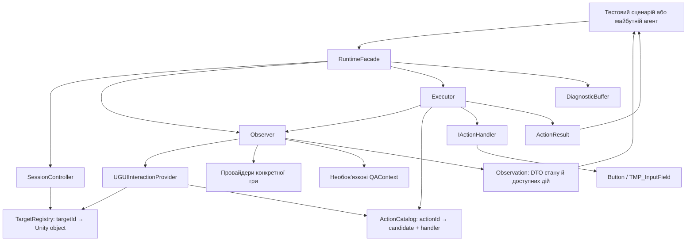
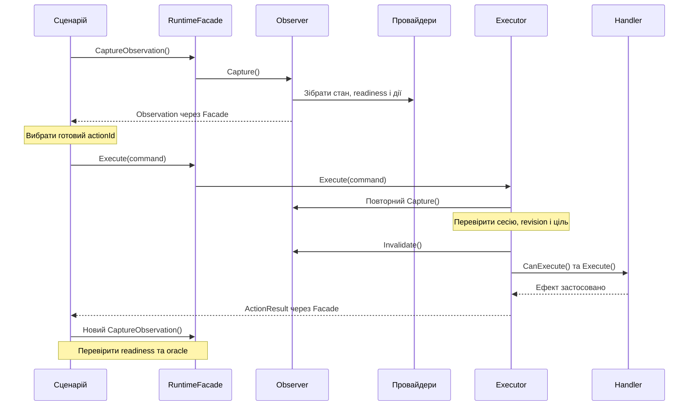

# Як працює AutoQA Runtime

Пакет надає інструменти для читання стану Unity та виконання запропонованих дій.
Він не містить AI або алгоритму вибору наступного кроку. Зараз вибір робить
тестовий сценарій; надалі його може робити зовнішній агент через той самий API.

## З чого почати читання коду

1. `RuntimeFacade` — публічні операції для клієнта.
2. `Observation`, `ActionCandidate`, `ActionCommand`, `ActionResult` — дані між клієнтом і Runtime.
3. `Observer` та `UGUIInteractionProvider` — звідки беруться дані й дії.
4. `Executor` — як перевіряється й виконується команда.
5. `SessionController`, `TargetRegistry`, `ActionCatalog` — де живе локальний стан.

## Основні зв'язки



Стрілки показують використання або передачу даних, а не окремі потоки чи процеси.
Виклики Runtime виконуються на головному потоці Unity. Game Adapter знаходиться
поза пакетом і реалізує потрібні інтерфейси провайдерів.

## Основні класи

| Клас | Відповідальність і спосіб роботи |
|---|---|
| `RuntimeFacade` | Єдина точка входу: створює Observer і Executor, надає початок/кінець сесії, capture, execute та статус команди. Перевіряє потік виклику й додає Unity-діагностику до observation. Потребує Dispose. |
| `SessionController` | Зберігає sessionId, registry, payload і результати команд та прапорець активного виконання. BeginSession очищає попередні дані. Це сесія автоматизації, не ігрова партія. |
| `TargetRegistry` | Видає об'єкту session-scoped targetId і зберігає живе посилання. Один живий об'єкт отримує той самий ID; знищені цілі прибираються під час capture. Між сесіями ID не є стабільним locator. |
| `Observer` | Збирає контекст, readiness, UI, дескриптори та oracle. Порівнює серіалізовану проєкцію з попередньою і змінює revision/observationId, якщо вона змінилася. У busy/unavailable не пропонує дій. Помилка провайдера дає unavailable і діагностику. |
| `CaptureContext` | Передає interaction provider три робочі об'єкти: observation для заповнення, registry та новий каталог. Не є додатковим станом гри. |
| `ActionCatalog` | Зберігає лише актуальні кандидати й handlers. Клієнт отримує DTO кандидата, а handler залишається локально в Unity. |
| `ActionCatalog.Entry` | Пара Candidate + Handler для одного actionId. |
| `Executor` | Перевіряє команду, сесію, повтор commandId, revision, готовність, ціль і handler. Перед виконанням повторно збирає observation; перед ефектом інвалідує старий каталог. Зберігає результат для повторного запиту. |
| `UGUIInteractionProvider` | Знаходить видимі Button/TMP_InputField. Читає підписи, значення й interactable. Для кнопок створює click; для полів — setValue на кожне запропоноване fixture-значення. Працює без public-властивостей в ігрових в'юшках. |
| `UGUIInteractionProvider.Handler` | Перевіряє контроль повторно. Для кнопки викликає onClick; для поля задає text і викликає onEndEdit. Це Direct mode, без емуляції миші, фокуса чи фізичного введення. |
| `QAContext` | Необов'язковий MonoBehaviour із Description та SemanticKey. Додає пояснення екрана/контролу; не потрібен для стандартних дій. |
| `ContextVisibility` | Відсіює неактивні об'єкти, вимкнені Canvas і прозорі CanvasGroup. Не доводить, що елемент не перекритий іншим вікном. |
| `DiagnosticBuffer` | Підписується на Unity logMessageReceived, зберігає останні 20 errors/exceptions/asserts, обрізаючи запис до 2048 символів. Dispose відписує callback. |

RuntimeFacade потрібно створювати саме на головному потоці: перевірка порівнює
поточний потік із потоком створення, а не самостійно знаходить Unity main thread.

## Контракти даних — Contracts.cs

Ці класи серіалізуються через JsonUtility і не містять UnityEngine.Object.

| Клас | Що передає |
|---|---|
| `Fact` | Один факт key/value. У поточній схемі значення текстові. |
| `Readiness` | ready, busy або unavailable та причину. Без провайдера — unavailable. |
| `CheckResult` | Результат ігрової перевірки, наприклад підтвердження готового gameplay. |
| `Element` | Дані UI-цілі: targetId, необов'язковий semanticKey, тип, назва, label, value та доступність. |
| `ContextDescription` | Текст дескриптора з ownerId і parentId для прив'язки до об'єктів. |
| `ActionCandidate` | Конкретну доступну дію, targetId та готове значення. Один елемент може мати кілька кандидатів. |
| `Observation` | Знімок, який об'єднує всі перелічені дані, scene/screen, sessionId, observationId і revision. |
| `ActionCommand` | Вибраний actionId, commandId та ідентичність стану, для якого його вибрано. |
| `ActionResult` | Статус операції, код причини, опис і час. completed не дорівнює успіху тесту. |

## Інтерфейси розширення — Providers.cs

Це контракти, а не готові компоненти, які потрібно всі додати на сцену.
Один Game Adapter може реалізувати кілька інтерфейсів.

| Інтерфейс | Хто й навіщо реалізує |
|---|---|
| `IGameContextProvider` | Гра додає screen і значущі факти в observation. |
| `IReadinessProvider` | Гра або явно обрана UI-політика повідомляє, чи можна робити наступний крок. |
| `ITestOracle` | Гра додає об'єктивні перевірки стану. |
| `ITestDataProvider` | Інтеграція задає готові значення для полів. Без них поле видиме, але setValue не пропонується. |
| `ISemanticProvider` | Необов'язково задає semantic keys і виключає дії зі сценарію, наприклад Exit. |
| `IInteractionProvider` | Модуль UI/gameplay знаходить цілі та створює кандидати й handlers. У пакеті є UGUI-реалізація. |
| `IActionHandler` | Реалізує перевірку CanExecute та сам ефект Execute для конкретної дії. |

## Один крок виконання



Приклад використання всередині MonoBehaviour або тесту на головному потоці:

```csharp
// gameAdapter реалізує потрібні провайдери конкретної гри.
using var runtime = new RuntimeFacade(
    new AutoQA.UGUI.UGUIInteractionProvider(gameAdapter, gameAdapter),
    gameAdapter, gameAdapter, gameAdapter);
runtime.BeginSession();
var observation = runtime.CaptureObservation();
if (observation.readiness.status != "ready" || observation.availableActions.Count == 0)
    return; // У повному сценарії: очікування з timeout або перевірка terminal state.

// Лише приклад API: реальний сценарій/агент обирає потрібного кандидата.
var candidate = observation.availableActions[0];
var result = runtime.Execute(new ActionCommand {
    commandId = System.Guid.NewGuid().ToString("N"),
    sessionId = observation.sessionId,
    observationId = observation.observationId,
    revision = observation.revision,
    actionId = candidate.actionId
});
```

Для повторного запиту тієї самої команди зберігають commandId і payload.
Для нового кроку отримують новий observation та створюють новий commandId.
Після completed гра може ще завантажувати сцену: готовність і успіх перевіряють
на наступних знімках. Timeout синхронного handler не скасовує вже зроблений ефект.

## Тестові класи пакета

| Клас | Призначення |
|---|---|
| `RuntimeTests` | Edit Mode перевірки JSON, revision, сесій, повторних команд і помилок. |
| `RuntimeTests.Fixture` | Мінімальна підміна interaction/readiness provider та handler із лічильником ефектів. |
| `UGUITests` | Play Mode тест справжніх Button/TMP_InputField, доступності та QAContext. |
| `UGUITests.Ready` | Тестова готовність ready та fixture-значення 7. Для довільної гри ця політика не підходить. |

Інтеграція та наскрізний сценарій Maze2D розташовані в Assets/AutoQA,
тому до цього переліку класів пакета не входять.
